<h1 align="center">futurestudy</h1>

<p align="center"><strong>Your Brooklyn College CS degree, mapped from first class to first job.</strong></p>

<p align="center">
Every Computer and Information Science (CISC) course at Brooklyn College, connected to its prerequisites,<br>
the careers it leads to, and free resources to learn it. Built on Snowflake and Cortex AI.
</p>

<p align="center">
  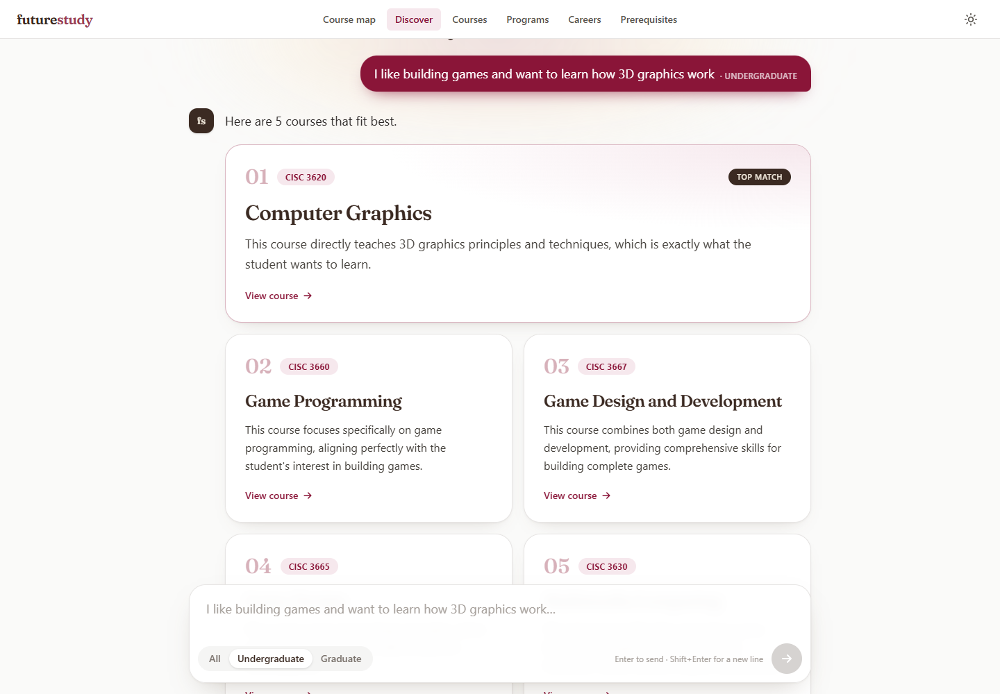
</p>

---

## Contents

- [What it does](#what-it-does)
- [How it works](#how-it-works)
- [Snowflake and Cortex AI](#snowflake-and-cortex-ai)
- [Data pipeline](#data-pipeline)
- [Backend API](#backend-api)
- [Frontend](#frontend)
- [Running it locally](#running-it-locally)
- [Configuration](#configuration)
- [Project layout](#project-layout)
- [Limitations](#limitations)

## What it does

Course catalogs list courses one at a time. They don't tell you which class unlocks which, what
job a course prepares you for, or where to learn the material for free. futurestudy pulls
Brooklyn College's catalog, bulletins, schedules, syllabi and degree maps into Snowflake. Cortex
AI reads every course and syllabus, and the app shows the result as a degree map, a chat-style
course finder, course and program pages, a prerequisite graph and a career explorer.

### Course map (home page)

Your major as an interactive roadmap, laid out left to right in the order you take the courses.
A dropdown switches between five maps: a hand-drawn map for the **Computer Science B.S.** (the
default), and maps for **Information Systems B.S.**, **Multimedia Computing B.S.** and both
**Computational Mathematics B.S.** options, generated from Brooklyn College's 2026-2027 degree
maps with one column per semester. The chosen major is kept in the URL (`/?program=...`), so a
map can be shared.

<p align="center">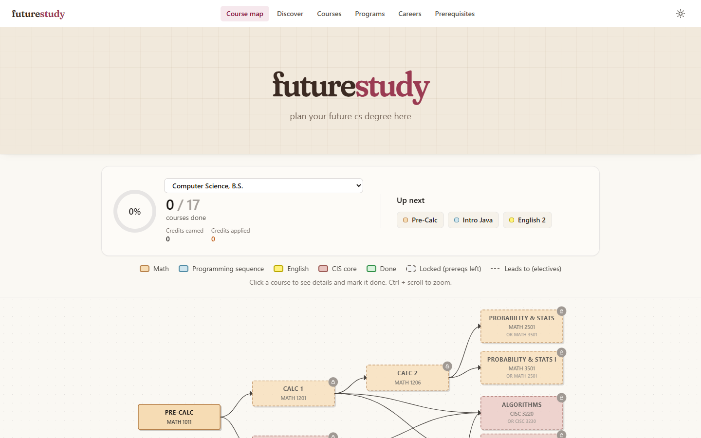</p>

- **Progress tracking.** Mark courses *Done* or *Taking now*. The progress ring, the courses-done
  count, live **Credits earned** and **Credits applied** totals, and the **Up next** list update
  as you go. Progress is saved in your browser (`localStorage`, key `future-study:map:v1`), so no
  account is needed.
- **Locks.** Courses whose prerequisites aren't done yet are dashed and show a lock badge.
- **Course drawer.** Click a course to open a side panel with its description, the catalog
  prerequisite rule, syllabus and catalog links, what it comes after, AI career paths and free
  resources. The map shifts left so the selected course stays visible, and the path through it is
  highlighted.
- **Choices and electives.** "Take one of" requirements appear as separate alternative boxes,
  long option lists become pick boxes ("One course from 5 options"), and each elective you choose
  gets its own box on the map.
- **Scrolling that behaves.** The mouse wheel scrolls the page, not the map. Ctrl + scroll, pinch
  or the on-canvas controls zoom.

<p align="center">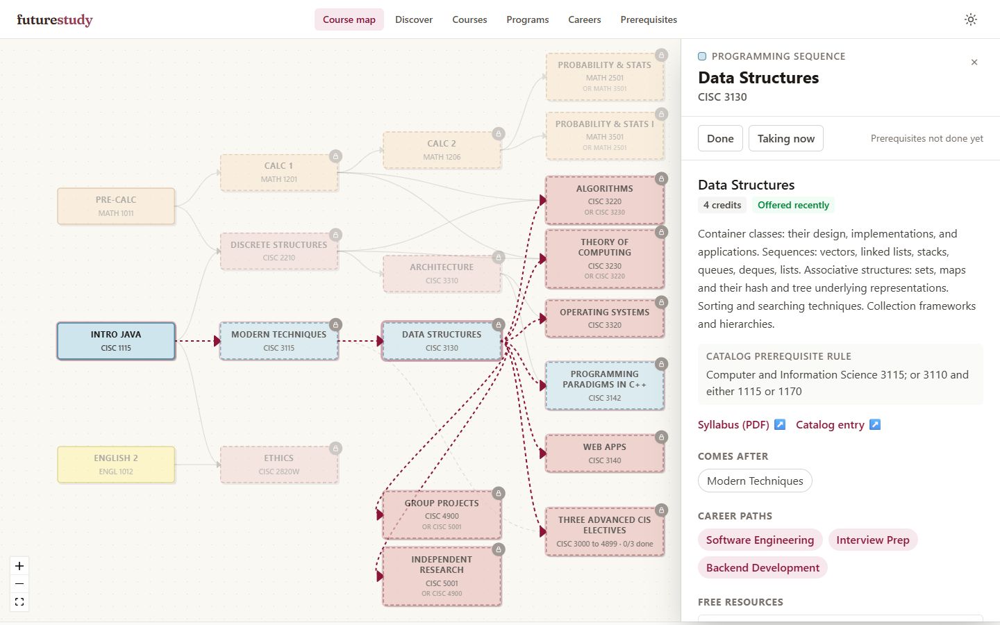</p>

### Discover: the course-finder chat

Describe what you're into in plain English ("I like building games and want to learn how 3D
graphics work", "I want to work in cybersecurity") and get ranked course recommendations, each
with a one-sentence reason tied to what you wrote.

<p align="center">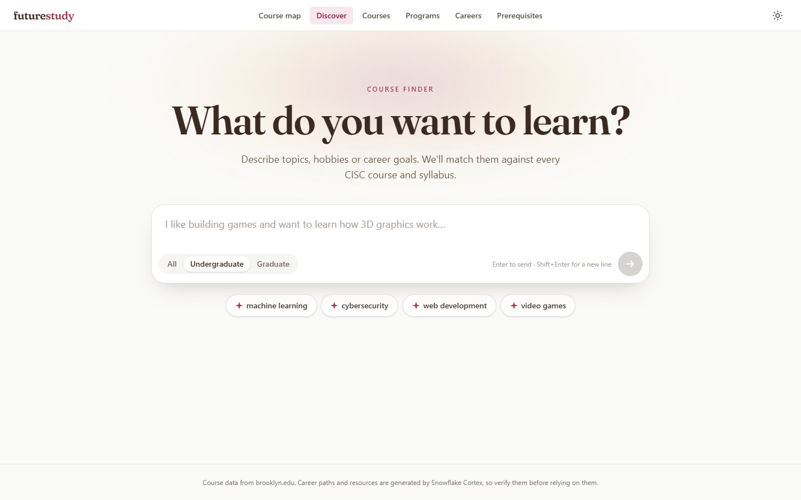</p>

- **A real chat thread.** Your message appears as a bubble. The reply appears under a
  futurestudy avatar, and follow-up questions stack into the same thread with the message box
  pinned to the bottom of the screen.
- **Typing indicator.** While Snowflake works, three pulsing dots run beside a status line that
  cycles through *Reading syllabi…*, *Matching your interests…*, *Ranking courses…* and
  *Writing reasons…*.
- **Rotating suggestions.** Four suggestion chips sit under the message box. Every few seconds one
  blurs out and a new one pops in, drawn from about 16 prompts. Rotation pauses while you hover or
  type, and clicking a chip fills the box.
- **Level filter.** A pill toggle limits results to Undergraduate, Graduate or all courses.
- **Result cards.** The top match gets a full-width card with a *Top match* badge, and the rest
  follow in a two-column grid. Each card shows a rank, the course code, the title, the AI's reason
  and a link to the course page. Other strong search hits are listed under *Also related*.
- **Keyboard first.** Enter sends, Shift+Enter adds a new line. All animation is turned off for
  users who prefer reduced motion.

<p align="center">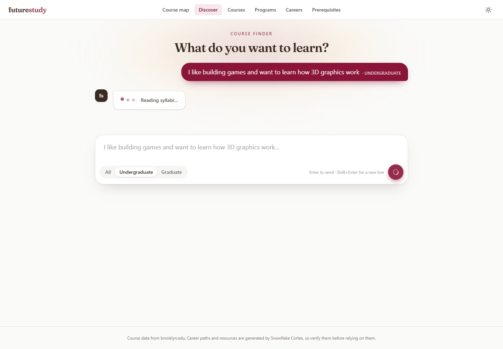</p>

### Course pages

Every one of the 172 CISC courses has a page with its description, credits, level, an
*Offered recently* flag, the exact catalog prerequisite rule, syllabus and catalog links,
AI-generated career paths (each with a relevance rating, an explanation and next steps), free
learning resources, topics and skills, what it requires, what it unlocks, and the programs it
belongs to. Prerequisites from other departments (MATH, ENGL, BUSN, ...) have pages too.

<p align="center">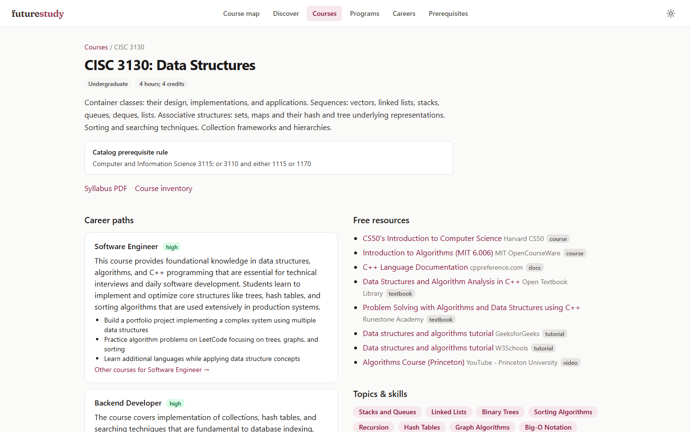</p>

The **Courses** list can be filtered by code, title or topic, by level, and by whether the
course was offered recently.

<p align="center">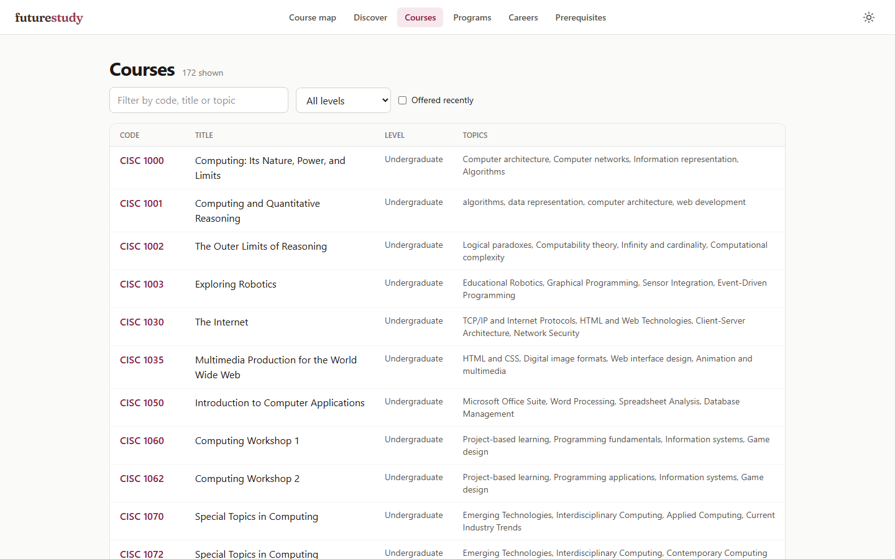</p>

### Programs

All 10 CIS programs (B.S., M.S., minors and certificates) with their overview, credits,
program-level career paths citing the courses behind them, free resources for the field, the
CISC courses they require, and a link to the program's prerequisite graph.

<p align="center">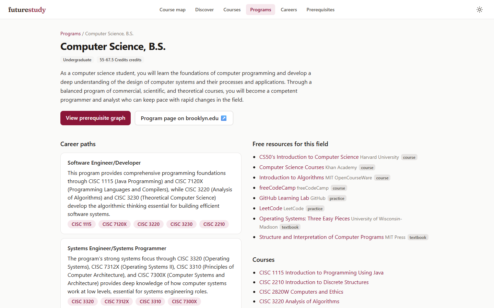</p>

### Prerequisite graph

The full prerequisite graph for any program, or the whole catalog, laid out automatically with
dagre. Undergraduate, graduate, out-of-program and non-CISC courses each have their own style,
and corequisites are dashed. Courses a rule names but that have no course page (core curriculum
courses, retired codes) still show their bulletin name, in a dotted box you can't open. Non-CISC prerequisites are followed back through their own
prerequisites (MATH 1201 → MATH 1011 → ...).

<p align="center">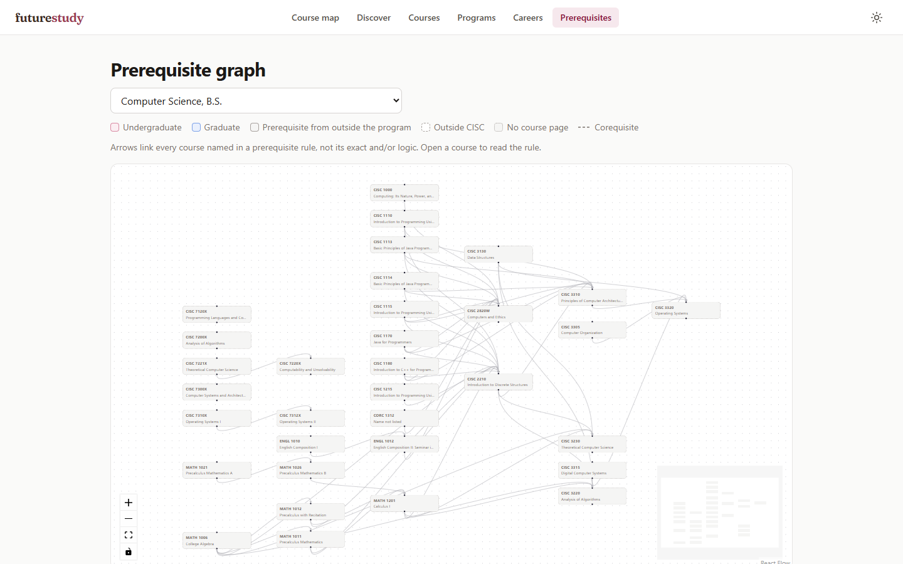</p>

### Career paths

About 140 career paths, ranked by how many courses lead to them. Expand one to see each
course that leads there, its relevance and why it helps.

<p align="center">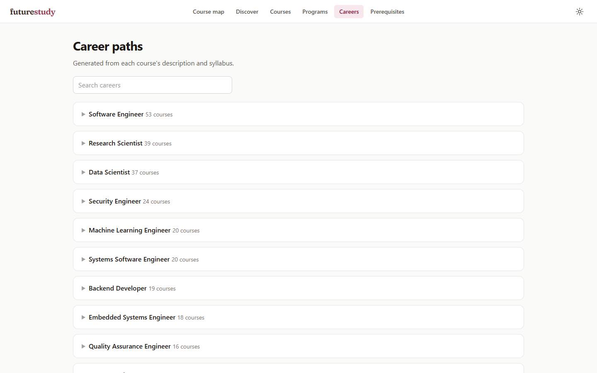</p>

### Dark mode

A sun/moon toggle in the header switches to a warm charcoal theme. The choice is remembered
(`future-study:theme`); until you pick one, the app follows your OS setting.

<p align="center">
  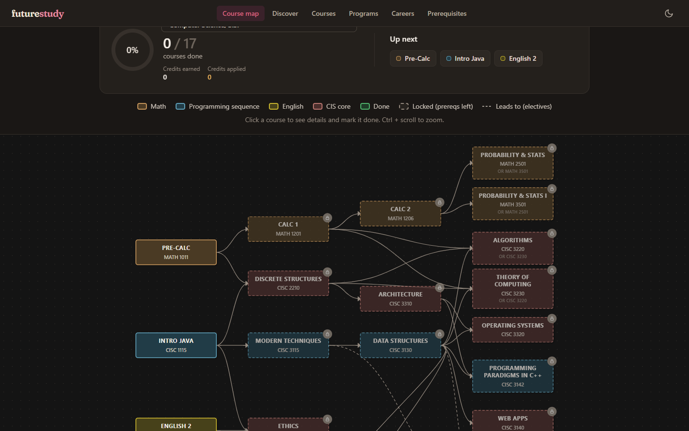
  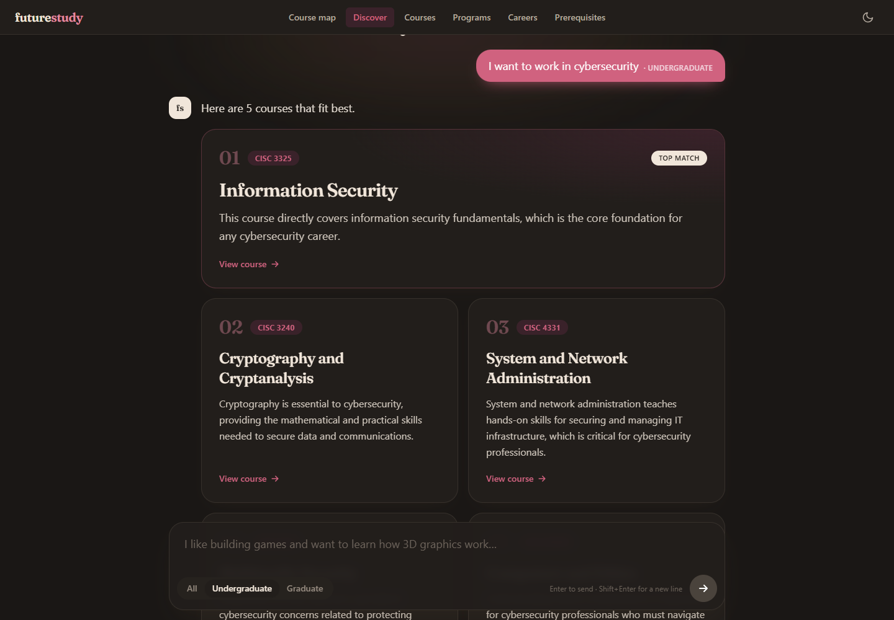
</p>

## How it works

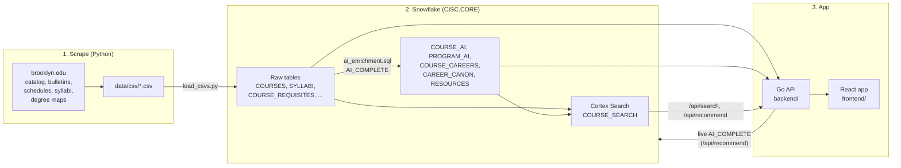

1. **Scrape.** Python scripts pull everything public about CIS courses from brooklyn.edu and
   write one CSV per table.
2. **Load and enrich.** The CSVs are loaded into `CISC.CORE`. One SQL script runs Cortex
   `AI_COMPLETE` over every course (description plus up to 12,000 characters of syllabus) and
   every program, stores the structured JSON, and builds a Cortex Search service.
3. **Serve.** A Go server queries Snowflake and serves both the JSON API and the built React app.
   Everything is precomputed except `/api/recommend`, which calls Cortex Search and
   `AI_COMPLETE` live for each question.

## Snowflake and Cortex AI

Everything the app knows lives in Snowflake, and every AI feature runs inside it.

| Snowflake feature | Where | What it does |
|---|---|---|
| Tables | `CISC.CORE.*` | Scraped catalog data, loaded with `write_pandas` |
| `AI_COMPLETE` with a JSON schema | `COURSE_AI` | Per course: topics, skills, 3 to 5 career paths (title, why, relevance, next steps) and 3 to 6 free resources from well-known providers |
| `AI_COMPLETE` with a JSON schema | `PROGRAM_AI` | The same for each program, with career paths citing the program's courses |
| `LATERAL FLATTEN` | `COURSE_CAREERS`, `RESOURCES` | Turns the AI JSON into relational rows the API can join |
| Plain SQL | `RESOURCES`, `COURSE_NAMES` | `curated_resources.sql` adds hand-picked links (Paul's Online Math Notes, Professor Leonard, The Organic Chemistry Tutor, W3Schools, GeeksforGeeks); `course_names.sql` names prerequisite courses that have no page |
| `AI_COMPLETE` (one call) | `CAREER_CANON` | Merges near-duplicate job titles ("Software Developer", "Backend Software Engineer") into canonical career paths so courses group cleanly |
| Cortex Search | `COURSE_SEARCH` | Hybrid search over title, description, AI topics, skills, careers and syllabus text, with `DIVISION` as a filter attribute |
| `AI_COMPLETE` live | `/api/recommend` | Ranks the search candidates for a student's interests and explains each pick |

All enrichment calls use `claude-sonnet-4-5` with low temperature (0.2, or 0 for career
canonicalization) and `response_format` JSON schemas, so the output parses into tables reliably.
`snowflake/ai_enrichment.sql` is re-runnable: every statement is `CREATE OR REPLACE`.

### How a recommendation is made

`POST /api/recommend` is retrieval-augmented generation done entirely in Snowflake:

1. **Retrieve.** `SNOWFLAKE.CORTEX.SEARCH_PREVIEW('CISC.CORE.COURSE_SEARCH', ...)` returns the
   10 best-matching courses for the student's text, filtered to the selected level.
2. **Rank and explain.** Those candidates go to `AI_COMPLETE` with a JSON schema asking for the
   3 to 6 best matches, best first, each with a one-sentence reason tied to the student's words
   (`temperature` 0.2, `max_tokens` 1500).
3. **Guard.** The Go handler keeps only course codes that were in the candidate list, so the
   model can't invent a course, and trims answers like `CISC 3130: Data Structures` back to the
   code.
4. **Respond.** The API returns the ranked `recommendations` plus all `candidates`. The UI shows
   candidates that weren't picked as *Also related*.

### Keeping resource links honest

AI-suggested URLs can be wrong. `snowflake/check_urls.py` requests every distinct URL in
`RESOURCES` (HEAD, falling back to GET when a site rejects HEAD) and writes the result to
`RESOURCES.URL_OK`. The API hides any resource where `URL_OK = FALSE`.

## Data pipeline

### Scrapers

| Script | Output | Notes |
|---|---|---|
| `scrape_brooklyn_cis.py` | Most of `data/csv/` | Programs, course inventory, undergraduate and graduate bulletin PDFs, department schedules, syllabi, related PDFs and degree maps. Flags: `--years 5` (window for "offered recently"), `--output data/csv`, `--cache data/cache/pdfs` |
| `scrape_prereq_courses.py` | `prereq_courses.csv`, `prereq_course_requisites.csv` | Looks up non-CISC courses named in CISC prerequisites and follows their own prerequisites (`--depth 3`). Run after the main scraper |
| `scrape_rmp.py` | `rmp_professors.csv` | Rate My Professors ratings for professors whose course tags match a CISC course. Collected for future use; the app doesn't show it yet |

"Offered recently" means listed as active in a bulletin, or on the department schedule, within
the last `--years` academic years (fall through spring). Downloads are cached under `data/cache/`
(gitignored) and requests are paced to be polite to brooklyn.edu.

### Tables

Each CSV becomes `CISC.CORE.<NAME>`. Course codes are written `CISC 3130` (department, space,
number, with optional suffixes such as `2820W` or `7100X`). `data/csv/manifest.csv` lists every
table with its row count.

| Table | Rows | Contents |
|---|---:|---|
| `programs` | 10 | CIS undergraduate, graduate and minor programs (`program_id` is the key) |
| `program_sections` | 93 | Overview and requirement text per program |
| `program_courses` | 71 | CISC courses named in each program's requirements |
| `courses` | 172 | Every CISC course found (`course_code` is the key) |
| `courses_offered_recent` | 153 | Subset of `courses` offered in the recent window |
| `course_requisites` | 374 | Prerequisite and corequisite edges. `group_id` and `group_operator` record the rule's and/or structure: required clauses, and `one_of` groups for "A or B" |
| `bulletins` / `bulletin_courses` | 19 / 807 | Bulletin PDFs parsed, and the course entries in each |
| `course_offerings` | 145 | Department schedule rows by term |
| `syllabi` | 91 | Full syllabus text per course, the main input for Cortex |
| `related_documents` | 9 | Other linked PDFs (prerequisite diagrams, checklists) |
| `degree_map_courses` | 1,135 | Four-year degree maps by program and bulletin year |
| `prereq_courses` | 52 | Non-CISC courses that CISC courses or programs require (`found` is false when the inventory has no page, as with CORC core courses) |
| `prereq_course_requisites` | 88 | Prerequisite edges among those non-CISC courses |
| `rmp_professors` | 115 | Rate My Professors ratings (not yet used by the app) |

AI tables built by `ai_enrichment.sql`: `COURSE_CONTEXT` (view), `COURSE_AI`, `PROGRAM_AI`,
`COURSE_CAREERS`, `CAREER_CANON`, `RESOURCES`, `COURSE_SEARCH_DOCS` and the `COURSE_SEARCH`
Cortex Search service. `curated_resources.sql` then adds hand-picked rows to `RESOURCES`, and
`course_names.sql` creates `COURSE_NAMES`.

## Backend API

Go (`net/http` with Go 1.22+ method routing) and
[`gosnowflake`](https://github.com/snowflakedb/gosnowflake). Code is in `backend/main.go`
(config, routing, static files) and `backend/handlers.go` (queries). Every response is JSON;
errors come back as `{"error": "..."}` with a 4xx or 5xx status.

| Endpoint | Returns |
|---|---|
| `GET /api/health` | `{"status": "ok"}` |
| `GET /api/courses?division=&recent=true` | Course list with AI topics. `division` is `Undergraduate` or `Graduate`; `recent=true` keeps courses offered recently |
| `GET /api/courses/{code}` | One course: details, career paths, free resources, topics and skills, prerequisites, what it unlocks, programs. Non-CISC prerequisites (for example `MATH 1201`) return details from `PREREQ_COURSES` |
| `GET /api/programs` | All programs with their CISC course counts |
| `GET /api/programs/{id}` | One program with sections, courses, career paths and general resources |
| `GET /api/graph?program={id}` | Prerequisite graph nodes and edges. Omit `program` for the whole catalog. Non-CISC prerequisites are followed back through their own prerequisites |
| `GET /api/careers?title=` | Canonical career paths with the courses that lead to them; `title` returns one career (case-insensitive) |
| `GET /api/search?q=&division=` | Up to 12 Cortex Search hits over course text, syllabi, topics and careers |
| `POST /api/recommend` | Body `{"interests": "...", "division": "Undergraduate"}`. Returns `{"recommendations": [{course_code, title, reason}], "candidates": [{course_code, title, division}]}` |

Example:

```bash
curl -s -X POST http://localhost:8000/api/recommend \
  -H 'Content-Type: application/json' \
  -d '{"interests": "I want to work in cybersecurity", "division": "Undergraduate"}'
```

Any path that isn't under `/api/` is served from the built frontend (`STATIC_DIR`), falling back
to `index.html` so client-side routes work on refresh. API requests are logged with their
duration.

## Frontend

| | |
|---|---|
| Framework | React 19 and TypeScript |
| Build | Vite 8 |
| Routing | TanStack Router with file-based routes and automatic code splitting |
| Styling | Tailwind CSS 4, with theme tokens and a few shared component classes in `src/styles.css` |
| Graphs | React Flow (`@xyflow/react`) for the course map and prerequisite graph, dagre for automatic layout |
| Fonts | Fraunces for the wordmark and display headings, loaded from Google Fonts |

Routes live in `frontend/src/routes/`:

| Route | File | Page |
|---|---|---|
| `/` | `index.tsx` | Hero and the course map for the chosen major (`src/components/map/`) |
| `/discover` | `discover.tsx` | Course-finder chat |
| `/courses`, `/courses/$code` | `courses/` | Course list and course pages |
| `/programs`, `/programs/$id` | `programs/` | Program list and program pages |
| `/graph` | `graph.tsx` | Prerequisite graph |
| `/careers` | `careers.tsx` | Career paths |
| `/map` | `map.tsx` | Redirects old links to `/` |

API calls and response types are in `src/api.ts`, shared components in `src/components.tsx`, and
the theme toggle in `src/theme.tsx`. The Computer Science map is laid out by hand in
`src/data/csMap.ts` with course text from `src/data/courses.json`; the other majors' maps come
from `src/data/programMaps.json`, built from `DEGREE_MAP_COURSES`, and `src/data/programMaps.ts`
lists them all. `python frontend/scripts/build_map_data.py` regenerates both JSON files from
Snowflake.

**Design.** Warm beige backgrounds, Brooklyn College maroon (`#8a1538`) as the accent, and the
lowercase `futurestudy` wordmark in Fraunces (espresso `#3b2a22` and rosewood `#9a3b52`). Dark
mode swaps the surface and stone tokens for a warm charcoal palette, so most components need no
`dark:` classes. Entrance animations use `motion-safe:`, so they don't run for users who prefer
reduced motion.

## Running it locally

### Prerequisites

- Python 3 (for the scrapers and Snowflake scripts)
- Go 1.22 or newer (`go.mod` targets 1.27)
- Node.js and npm
- A Snowflake account with Cortex enabled and access to `claude-sonnet-4-5` (check with
  `SHOW CORTEX BASE MODELS;`)

### 1. Credentials

Set Snowflake credentials as environment variables. Never commit them.

```bash
export SNOWFLAKE_ACCOUNT=... SNOWFLAKE_USER=... SNOWFLAKE_PASSWORD=... SNOWFLAKE_WAREHOUSE=COMPUTE_WH SNOWFLAKE_ROLE=SYSADMIN
```

```powershell
$env:SNOWFLAKE_ACCOUNT = '...'; $env:SNOWFLAKE_USER = '...'; $env:SNOWFLAKE_PASSWORD = '...'; $env:SNOWFLAKE_WAREHOUSE = 'COMPUTE_WH'; $env:SNOWFLAKE_ROLE = 'SYSADMIN'
```

Or copy `backend/.env.example` to `backend/.env` (gitignored), fill it in, and load it into your
shell with the one-liner at the top of that file.

### 2. Data (only when the CSVs change)

The scraped CSVs are committed, so you can skip scraping and go straight to loading.

```bash
pip install -r requirements.txt "snowflake-connector-python[pandas]"
python scrape_brooklyn_cis.py                             # optional: re-scrape brooklyn.edu
python scrape_prereq_courses.py                           # optional: non-CISC prerequisites
python snowflake/load_csvs.py                             # CSVs -> CISC.CORE tables
python snowflake/run_sql.py snowflake/ai_enrichment.sql   # Cortex enrichment, about 2 minutes
python snowflake/run_sql.py snowflake/curated_resources.sql  # hand-picked links; rerun after ai_enrichment.sql
python snowflake/run_sql.py snowflake/course_names.sql    # names for prerequisite courses with no page
python snowflake/check_urls.py                            # mark broken resource links
python frontend/scripts/build_map_data.py                 # optional: rebuild the course map data
```

`load_csvs.py` accepts `--database` and `--schema` (default `CISC` and `CORE`). `run_sql.py`
runs a SQL file one statement at a time and prints each statement's timing.

### 3. App

Production-style, one server on one port:

```bash
cd frontend && npm install && npm run build && cd ..
cd backend && go run .            # http://localhost:8000
```

For frontend development with hot reload, run the API on port 8001 and Vite alongside it. Vite
proxies `/api` to `127.0.0.1:8001`.

```bash
cd backend && PORT=8001 go run .
cd frontend && npm run dev        # http://localhost:3000
```

## Configuration

| Variable | Used by | Default | Purpose |
|---|---|---|---|
| `SNOWFLAKE_ACCOUNT` | backend, scripts | | Account identifier |
| `SNOWFLAKE_USER` | backend, scripts | | Login name (the backend also accepts `SNOWFLAKE_USERNAME`) |
| `SNOWFLAKE_PASSWORD` | backend, scripts | | Password authentication |
| `SNOWFLAKE_WAREHOUSE` | backend, scripts | `COMPUTE_WH` | Warehouse for queries |
| `SNOWFLAKE_ROLE` | backend, scripts | | Role, for example `SYSADMIN` |
| `SNOWFLAKE_TOKEN_FILE_PATH` | backend, scripts | | OAuth token file; used instead of a password when set |
| `SNOWFLAKE_HOST` | backend, scripts | | Host override, used with OAuth |
| `SNOWFLAKE_AUTHENTICATOR` | backend | | Set to `externalbrowser` for browser SSO |
| `SNOWFLAKE_DATABASE` / `SNOWFLAKE_SCHEMA` | backend | `CISC` / `CORE` | Where the app's tables live |
| `CORTEX_MODEL` | backend | `claude-sonnet-4-5` | Model for live recommendations |
| `PORT` | backend | `8000` | HTTP port |
| `STATIC_DIR` | backend | `../frontend/dist` | Built frontend to serve |

The backend authenticates with OAuth when `SNOWFLAKE_TOKEN_FILE_PATH` is set, then browser SSO
when `SNOWFLAKE_AUTHENTICATOR=externalbrowser`, and otherwise with a password.

## Project layout

```
.
├── scrape_brooklyn_cis.py       main scraper: programs, courses, bulletins, schedules, syllabi, degree maps
├── scrape_prereq_courses.py     non-CISC prerequisite courses
├── scrape_rmp.py                Rate My Professors ratings
├── scraper/                     separate, smaller course-catalog scraper with its own README
├── requirements.txt             Python dependencies (pandas, requests, BeautifulSoup, pypdf)
├── data/csv/                    scraped tables, ready for Snowflake (manifest.csv lists them)
├── snowflake/
│   ├── load_csvs.py             CSVs -> CISC.CORE tables
│   ├── run_sql.py               runs a .sql file statement by statement
│   ├── ai_enrichment.sql        Cortex AI_COMPLETE enrichment and the Cortex Search service
│   ├── curated_resources.sql    hand-picked free resources added to RESOURCES
│   ├── course_names.sql         names for prerequisite courses with no page
│   └── check_urls.py            verifies resource links
├── backend/
│   ├── main.go                  Snowflake connection, routes, static file serving
│   ├── handlers.go              API handlers and SQL
│   └── .env.example             template for local credentials
├── frontend/
│   ├── src/routes/              pages (file-based routing)
│   ├── src/components/map/      course map: Roadmap, CourseNode, CourseDrawer
│   ├── src/data/                course map layouts and data for every major
│   ├── src/api.ts               API client and types
│   ├── src/styles.css           Tailwind theme, dark mode tokens, shared classes
│   └── scripts/build_map_data.py  rebuilds src/data/courses.json
└── docs/screenshots/            images used in this README
```

## Limitations

- **AI output can be wrong.** Career paths, reasons and resources are generated by Cortex from
  course descriptions and syllabi. The app says so in its footer; check anything important
  against the Brooklyn College bulletin.
- **Prerequisite logic is approximate.** `course_requisites` groups each rule into required
  clauses and "one of" groups, but nested rules ("3110 and either 1115 or 1170") are simplified,
  and the prerequisite graph draws every course a rule names. Course pages show the raw catalog
  rule wherever the exact rule matters.
- **Syllabi are partial.** 91 syllabi cover part of the catalog; courses without one are enriched
  from their description alone.
- **Course maps cover the B.S. majors.** Minors, the M.S. and certificates get a prerequisite
  graph but no roadmap.
- **Rate My Professors data** is scraped but not shown yet. RMP's terms prohibit scraping, so
  pulls are kept rare and cached.

---

<p align="center">
Built for a hackathon. Course data from
<a href="https://www.brooklyn.edu">brooklyn.edu</a>; AI by Snowflake Cortex.
</p>
